# CSV Plot Studio

A desktop app that turns a CSV file into matplotlib / seaborn plots without writing code,
and then **shows you the code** so you can paste it into Jupyter or a Kaggle notebook.

1. Pick a graph type (30 of them, from the *Python Data Science Handbook* chapter 4 plus common ML plots)
2. Load a CSV: it is scanned automatically (delimiter, encoding, number / category / date columns, missing values)
3. Choose the columns and rows (the app pre-fills sensible suggestions)
4. Press **Plot**. Zoom, pan, save as PNG/SVG/PDF, open in its own window, or copy the code

New in 3.4.0: the **Notebook** works like a chat. Paste a photo or screenshot of a statistics problem on the left,
and the worked solution streams in on the right with its math drawn. It reads the picture with a local vision model
(Ollama, offline) and never asks you to fix the reading. See [Notebook](#notebook-a-photo-of-a-problem-in-a-worked-solution-out).

New in 3.3.0: tables from PDFs and images are read correctly and never changed behind your back (both tables on
a page, merged headings, rotated pages, password-protected files, borderless screenshots, phone photos); every
import opens in one review dialog where you can fix any cell, and is saved as a CSV where you choose with a small
`<name>.source.json` note of where it came from. The profile dashboard shows only what you really did (no sample
numbers), counts the plots you ask for (not every automatic redraw), works from the keyboard, uses the app's own
Plex fonts, and the whole app now shares its coral accent and soft gradients.

The **profile** dashboard (the button with your character and name in the header) keeps a local history of your
plots, files, Feature Lab features and exports: an activity calendar (month / quarter / year), your level, recent
activity and six badges you earn by using the app. Edit your name and character from the profile card.

New in 3.0: the **Feature Lab** tab. Pick the target and the Lab suggests new columns for a model (the title in a
passenger's name, family size from siblings + parents, ratios, date parts, a flag for gaps …), measures each one
against the target (*MI 0.000 → 0.163 (+0.163)* plus the reason in words), flags **leakage** in red (one-click
Accept is blocked) and near-copies, and previews the first rows with two plots. **Accept** turns a suggestion into
a step: the new column appears in every tab and in the plot code, with **Undo / Redo**. Type your own formula
(`Fare / (family_size + 1)`; it is checked piece by piece and never run with `eval`). **Evaluate with model**
cross-validates a linear model and gradient boosting without and with the new columns and says when a gain is
*not significant*. **Export** writes the steps as `clean.py`, a notebook or a **Kaggle submission**, and they
rebuild exactly the table you see. See [Feature Lab](#feature-lab) below.

Fixed in 3.0.1 (a review of 3.0; each claim was reproduced before anything was changed, see the [verification
report](docs/reviews/v3.0.1_verification_report.md)): a line break in a CSV value, a column name or a formula can no
longer turn into plot or step code, and `clean.py` compiles whatever the data file is called; exported plot scripts
import numpy when a Feature Lab step needs it; renaming a step keeps the formulas, target encodings and other steps
built on it working and refuses names that are already taken; `not` / `and` / `or` in a formula are logical on 0/1
and number columns (a gap counts as false); *Suggest* and *Data summary* score links exactly like the Plot ideas
(bias-corrected η and V, ρ for curved links, the same 50,000-row sample); bins and logs of one column always read
*Same information, new shape*; the linear model in *Evaluate* one-hot encodes bins and numbers read as groups, so
bins can help it; curved links on log axes are suggested as a scatter instead of a straight fit; differences of
numbers that are often 0 (delays, discounts) are suggested; day-first dates (31/12/2024, 01.02.2024) are read day
first, and values that were not dates, or lines with only separators above the header, are mentioned in a note;
numbers written like 1.234,56 are no longer lost as gaps; Plot ideas and Column types work for column names with
spaces around them; *skip* under Column types leaves a column out of the slots, Suggest, Plot ideas and Evaluate;
Column types and the plot follow Feature Lab undo / redo; a pie of zeros and correlations of one-value columns say
what is wrong instead of failing inside matplotlib; a Kaggle submission names the columns the test file lacks and
explains when nothing is left to train on; and the pattern ideas no longer raise a FutureWarning on pandas 2.2.

New in 2.2: the **Plot ideas** tab became a full suggestions panel: pick the **Target** right there, the
**warnings come first** (red leakage, orange important, yellow worth checking), every suggestion has a **Plot it**
button, and **Column types…** lets you say how a column should be treated (e.g. `age` as groups, `pclass` as a
number) and runs everything again. Big files show *computed on a 50,000-row sample*. Errors open a dialog and the
details go to `~/.csv_plot_studio.log`. All analysis now lives in `plotstudio/core/` (no window code), with a pytest
suite that runs the Titanic and tips checks.

Fixed in 2.2.1 (a trial of every graph type and option, each checked against numbers worked out with pandas):
pair plots no longer crash when you type X / Y labels, the legend setting now works on pair plots, facet grids and
joint plots, the regression equation reads *y = 2x − 3* instead of *y = 2x + -3*, correlation / pivot / confusion
heatmaps size themselves so names and numbers never collide (row names read flat, long column names turn upright),
long titles wrap instead of running off the figure at the bigger Text sizes, pair plot axis names are no longer cut
off, the contour *image* style puts each cell on its grid point without grid lines over it, and a confusion matrix
of a *yes / no* column against *0 / 1* predictions turns the classes into 0 / 1 (and says so) instead of showing
0% accuracy.

New in 2.1: **Plot ideas**. Load a CSV and the app tells you what to plot first: the target, then the columns most
linked to it, then overview plots (missing values, correlations, time) and other strong pairs, each with a reason in
plain words and the numbers behind it (*"Survived = 1 in 74% of Sex = female, 19% of male (V = 0.54, n = 891)"*).
Click an idea and it is drawn, with the code. It also warns about **leakage** (a column that gives the target away),
**near-copies** (`class` = `pclass`), heavy gaps and skew. The ideas appear in the gallery and in the new
*Plot ideas* tab; they are worked out in the background, on a 50,000-row sample of big files.

New in 2.0, a new look: **rounded, flat controls** with a short halo when you click them, eased (smooth)
scrolling with slim scrollbars, more room between controls, the **IBM Plex** typeface (bundled, nothing to
install), keyboard focus rings and sliders you can move with the arrow keys, and the **Studio** chart style:
a colour-blind-safe palette, thinner lines, a hairline grid, no box around the plot and left-aligned titles.
The style is written into the code as a short `plt.rcParams.update({...})` block, so the plot looks the same in
your notebook. See [DESIGN.md](DESIGN.md) for the design system.

New in 1.2: **move and zoom the plot with the mouse** and **column suggestions** for every slot (pick the *Target*
and each slot's **Suggest** list ranks the columns by how strongly they are linked to it).
New in 1.1: a **dark look**, **ball sliders** for the X / Y ranges and every number setting, and a **ball that
follows the mouse** and shows the value of the nearest point.

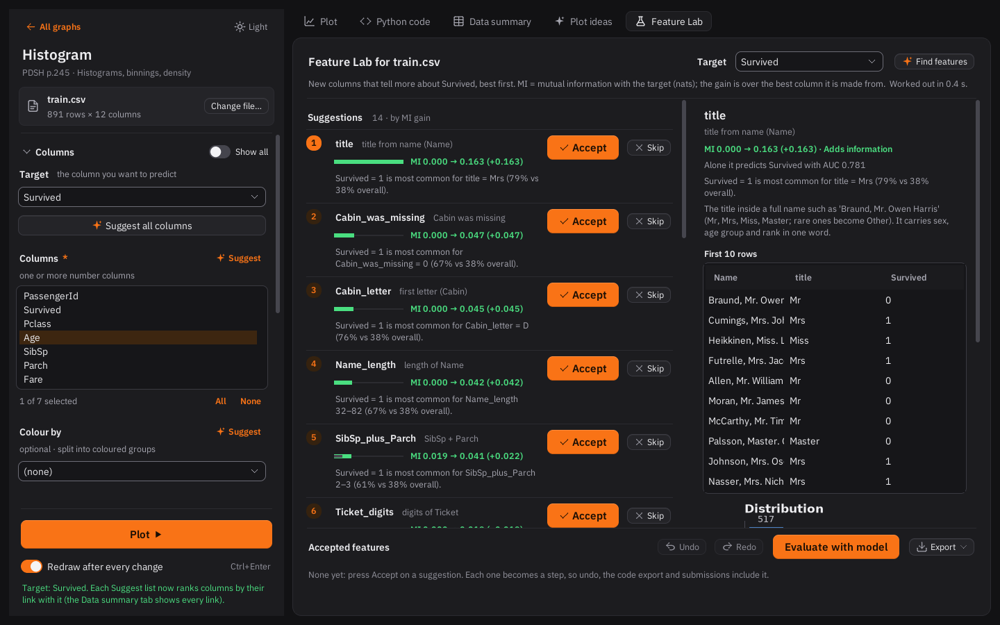
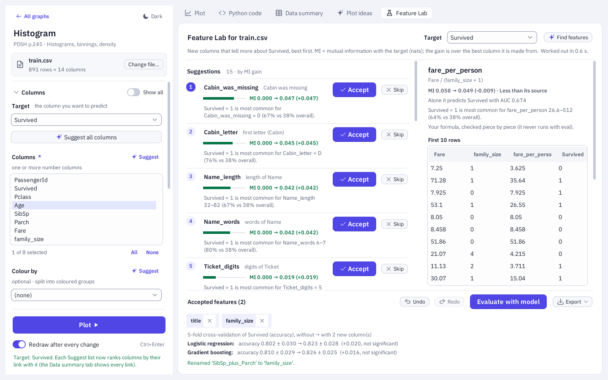
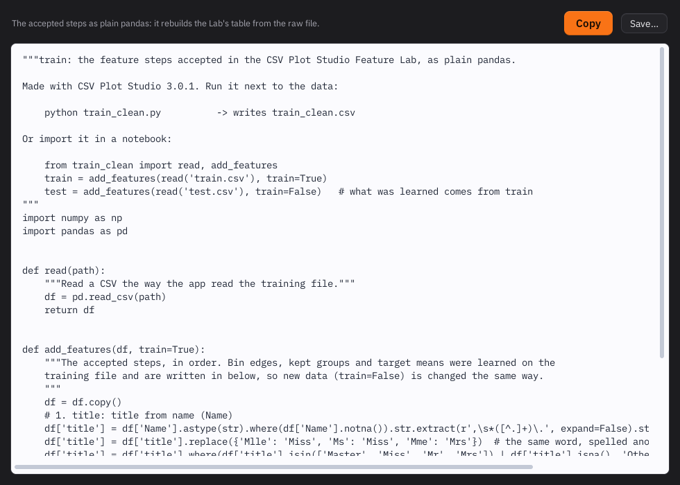
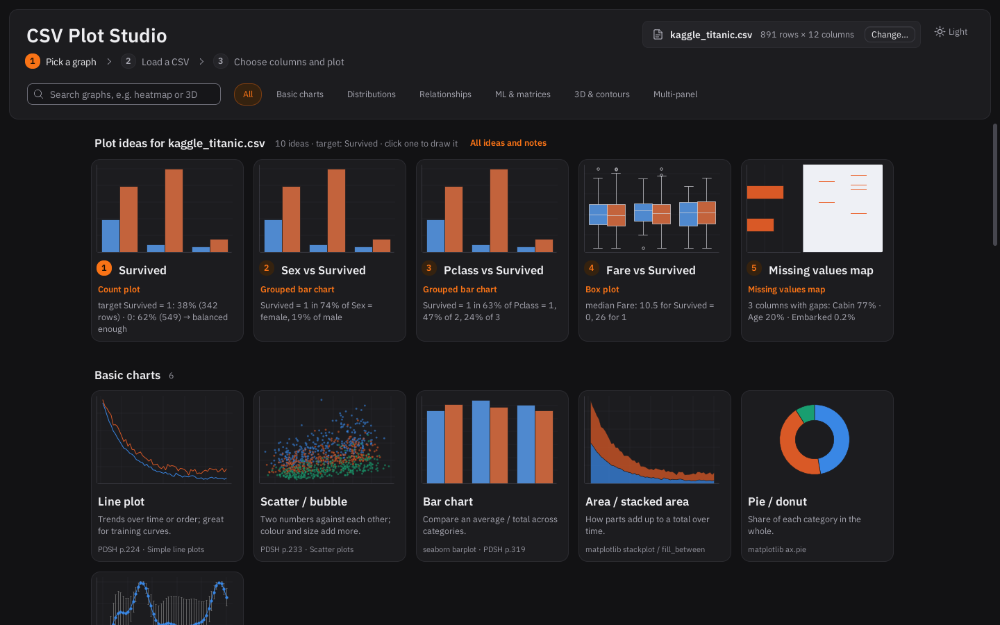
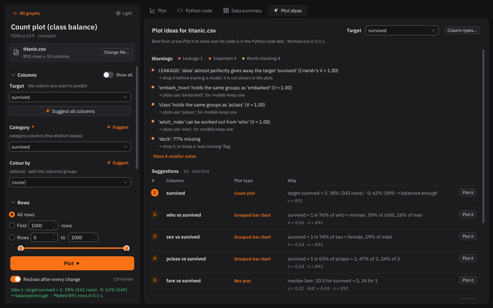
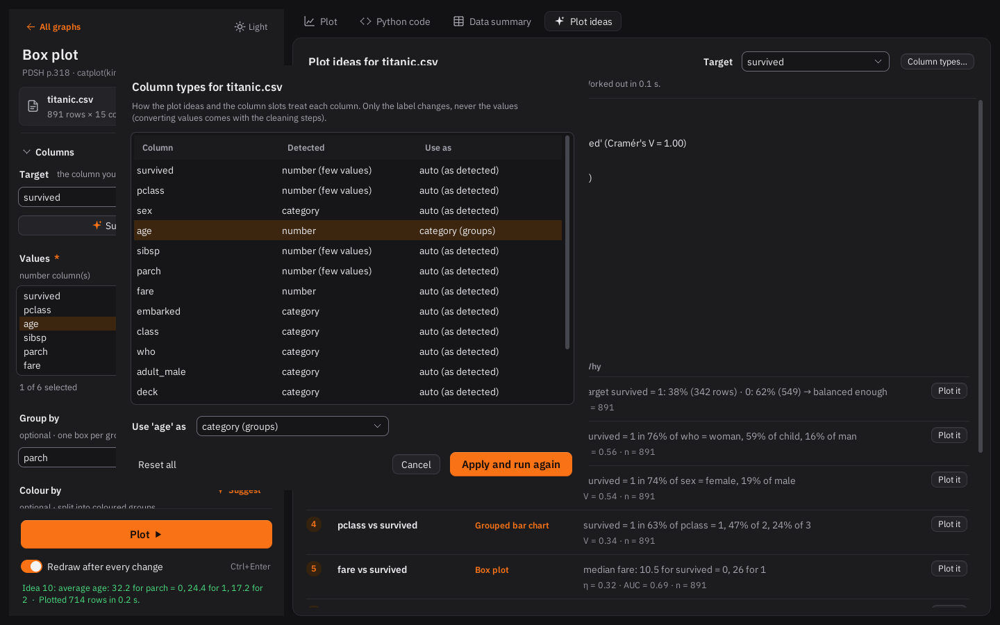
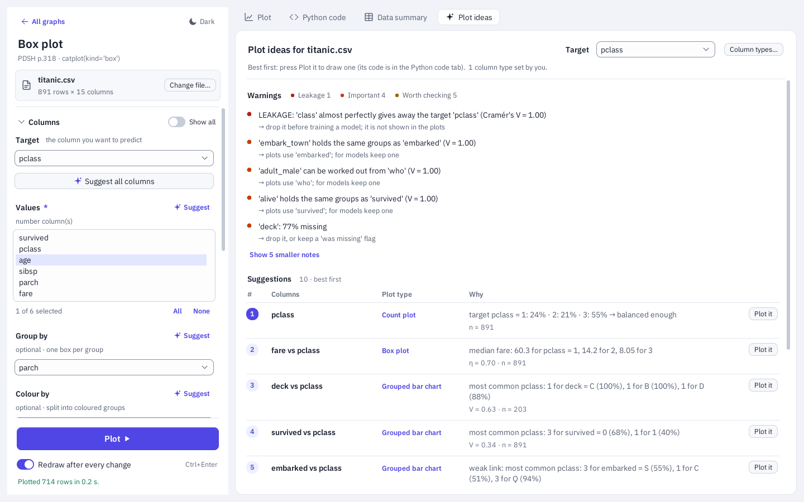
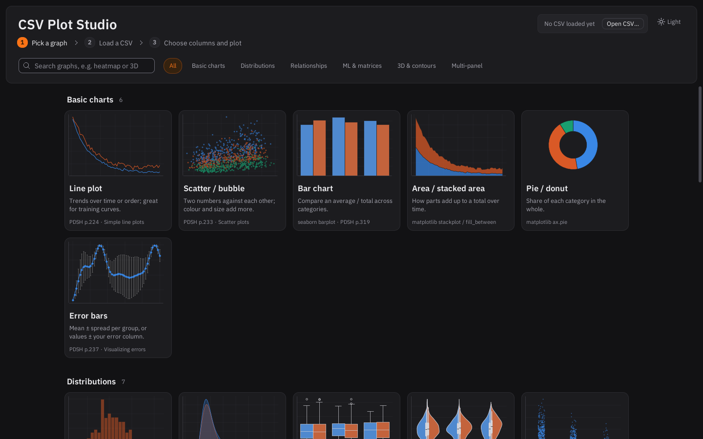
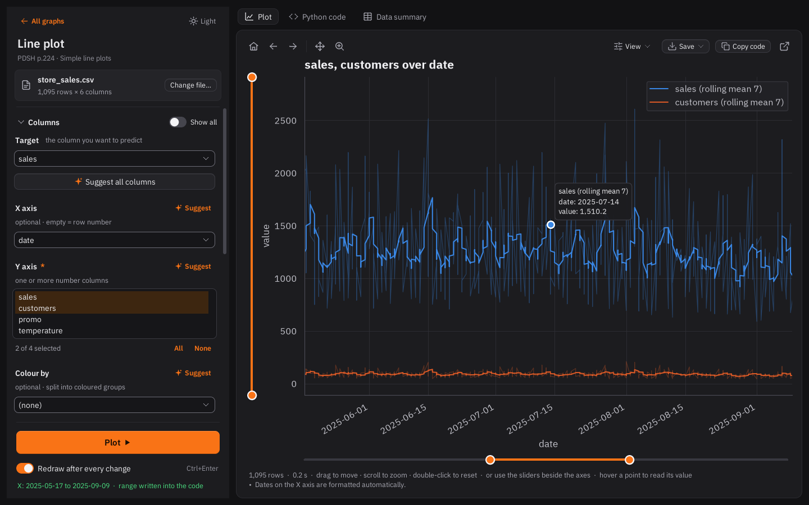
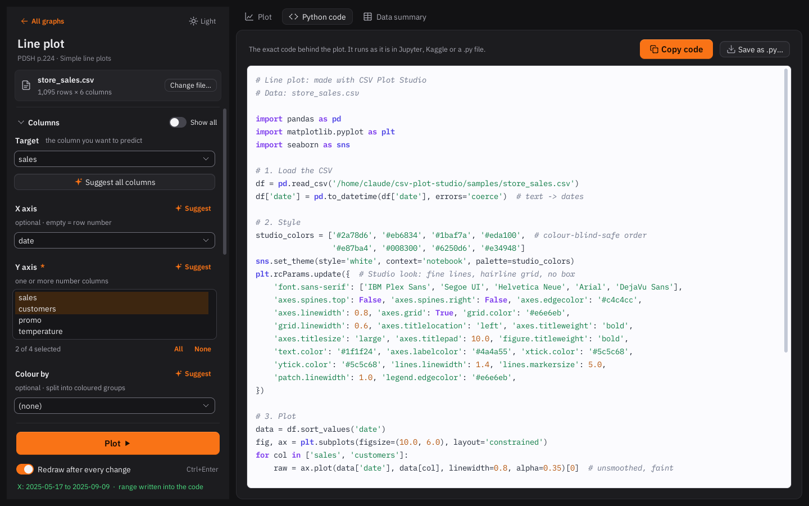
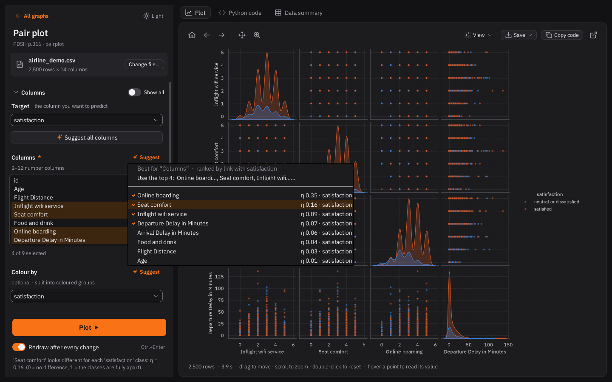
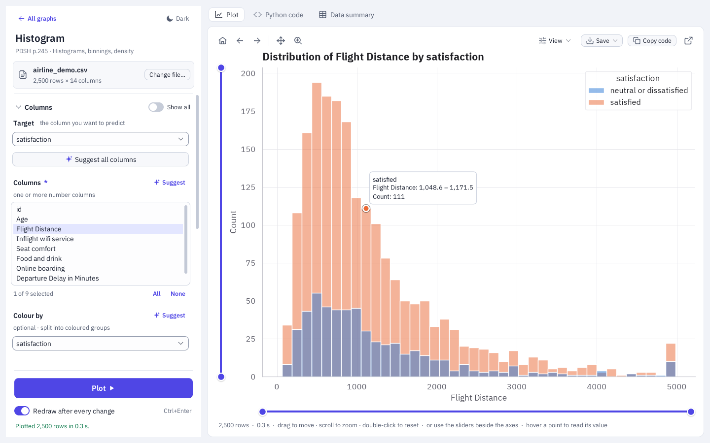

---

## Start it

Run the starter for your computer. It creates a private app environment and downloads missing Python libraries
automatically. The first start needs an internet connection.

### Windows

Double-click **`run_windows.bat`**. There is nothing else to install: the first start sets up everything by itself.
* **Python 3.12**, if the PC has none: through Windows Package Manager, or else from python.org. The installer runs
  only if it is signed by the Python Software Foundation.
* **The app's Python packages**, in a private environment next to the app (`.venv`).
* **Ollama and the Notebook's reading model** (`qwen3-vl:8b-instruct`, about 1.6 GB + 5 GB). This runs in the
  background once the window is open, and the Notebook shows its progress. Ollama comes through Windows Package
  Manager, or else from ollama.com, and runs only if it is signed by Ollama Inc. It installs for the current user
  and needs no administrator rights. The app can be used meanwhile, and typed problems work right away.
* **Tesseract OCR** for tables from pictures and scans, through Windows Package Manager in the background. Windows
  may ask once for permission.

The first start needs about 10 GB of free disk space and takes 15–45 minutes, depending on the connection.
Later starts take a few seconds and need no internet. Set `CSV_PLOT_STUDIO_NO_SETUP=1` to switch the
automatic Ollama, model and Tesseract setup off.

To hand the app to others, run `python scripts/make_beta.py`. It writes `dist/CSV-Plot-Studio-<version>-beta.zip`
with only the app's files and a short *READ ME FIRST.txt*.

Want it on the desktop? Right-click `run_windows.bat` > *Send to* > *Desktop (create shortcut)*.

### Linux Mint / Ubuntu

```
./run_linux.sh
```

`run_linux.sh` creates a private `.venv`; `main.py` downloads any missing Python libraries automatically. Python 3 with
Tkinter is still needed from the system. On Ubuntu or Mint, if the app reports that Tkinter is missing, run
`sudo apt install python3-tk` once and launch it again. The OCR engine is installed automatically when the starter is
run as an administrator; otherwise a system administrator may need to install it.

To put it in the Mint menu (and in *Open With* for CSV files), run once: `./install_linux_shortcut.sh`

### Handy extras

```
python main.py data.csv                         # open straight into a file
python main.py --csv data.csv --graph corr --plot   # file + graph + draw immediately
python plot_recommender.py data.csv target      # plot suggestions and warnings in the terminal
pip install -r requirements-dev.txt             # once: pytest
python -m pytest                                # all tests (about 4 minutes; -m "not slow" skips the two slowest)
python tests/smoke_test.py                      # only: all 30 graph types and every exported script
```

Keyboard: **Ctrl+Enter** or **F5** = plot, **Ctrl+O** = open CSV, **Ctrl+S** = save image.
**Tab** moves between the controls (a ring shows where you are; it only appears when you use the keyboard),
**Space** / **Enter** presses buttons and opens gallery cards.
On the plot (after clicking it): arrow keys move, **+** / **−** zoom, **0** shows everything.
On a ball slider: arrow keys move the ball (Shift: bigger steps), **Space** switches between the two balls,
**Home** / **End** go to the ends, **Escape** resets. Double-click the plot or a slider to reset it.

---

## The graph types

| Group | Graphs |
|---|---|
| **Basic charts** | Line plot, Scatter / bubble, Bar chart, Area / stacked area, Pie / donut, Error bars |
| **Distributions** | Histogram, Density (KDE), Box plot, Violin plot, Strip / swarm, ECDF (cumulative), Q-Q plot (normality) |
| **Relationships** | Regression fit (with R² and residuals), Joint plot, Hexbin / 2D histogram, 2D density contours, Pair plot |
| **ML & matrices** | Correlation heatmap, Correlation with target, Count plot (class balance), Missing values map, Pivot heatmap, Confusion matrix, ROC / PR curve, Image grid (pixel rows, MNIST style) |
| **3D & contours** | Contour plot, 3D scatter / line, 3D surface / wireframe |
| **Multi-panel** | Facet grid (small multiples, like the book's `FacetGrid`) |

Every card in the gallery shows the Handbook page it comes from, e.g. *PDSH p.245 · Histograms*.

---

## Using it

**Columns.** Each graph asks for the columns it needs (X axis, Y axis, Colour by, …). Each list only shows the
columns of the right type; turn on **Show all** to override. Columns you pick by hand are remembered when you switch to
another graph.

**Suggestions.** At the top of *Columns* choose the **Target**, the column a model would predict (the app guesses it,
e.g. `satisfaction`, `Survived`, `price`). Every slot has a **Suggest** link: it lists the best columns for that
slot with the reason, best first, and hovering an entry explains the number in the status line:

| Reason | Meaning |
|---|---|
| `r +0.82 · price` | correlation between two number columns (−1 … +1; 0 = no straight-line link) |
| `ρ +0.61 · price` | rank (Spearman) correlation, shown instead of r when the link is curved (\|ρ\| > \|r\| + 0.1) |
| `η 0.35 · satisfaction` | how much a number differs between the classes (0 = not at all, 1 = classes fully apart) |
| `V 0.29 · satisfaction` | Cramér's V between two group columns (0 = unrelated, 1 = one decides the other) |
| `your target`, `dates`, `always increasing`, `0–1 values`, `4.1% missing`, `skew +2.1`, … | why a column fits that slot |

So the X axis of a scatter suggests the features most linked to the target, the Y axis the next best one (or the
target itself when it is a number), *Colour by* the target class, a box plot's *Group by* the target, a line plot's
X axis the date column, the missing-values map the columns with gaps, a ROC curve the 0–1 probability columns.
Without a target the suggestions use pairs of columns that move together and the shape of the data.
**Suggest all** fills every slot at once and draws the plot. The *Data summary* tab shows the link of every column
with the target; click a column heading to sort the table by it.

**Plot ideas.** As soon as a file is loaded the app ranks the plots worth drawing first (gallery row
*Plot ideas for …* and the **Plot ideas** tab). In the tab, the **Target** box at the top is the same setting as
*Target* under Columns; the **warnings** come first, then the suggestions as a table (rank · columns · plot type ·
why, with the number behind it) and a **Plot it** button that draws the plot and writes its code. **Column types…**
changes how a column is treated without touching its values: a number as groups (`age` → category), groups as a
number (`pclass` → number), a column as an ID, text or skipped. The plot slots and the *Data summary* follow, and
the ideas are worked out again. (Turning text into numbers is a cleaning step and comes with the cleaning pipeline.)
How the ideas are chosen:

1. **Column kinds**: number, category (also numbers with ≤ 15 values, like `pclass`), date, ID-like, text, constant.
   IDs, free text and one-value columns are not plotted; the target never is skipped.
2. **Single columns** worth a look: strong skew, outliers, one dominant value.
3. **Pairs** on one 0–1 scale: number–number = max(|Pearson r|, |Spearman ρ|), group–number = η (correlation ratio),
   group–group = Cramér's V, date–number = trend (ρ against time). η and V are bias-corrected, so a column with
   hundreds of tiny groups (ticket codes) can't look important by accident.
4. **Ranking**: the target first, its 4 strongest links, overview plots (missing values map, correlation heatmap,
   correlation with target, pair plot, the target over time), then other pairs. No column appears more than twice.
5. **The plot** fits the data: grouped bars for two group columns, box (skewed) or violin plots for a number by group,
   scatter + trend line (hexbin for > 10,000 rows) for two numbers, a line over time for dates and epochs, log scales
   for skewed positive numbers.

The warnings are sorted by importance: red = **leakage** (e.g. `alive` is a copy of `survived`: drop it
before training), orange = important (near-copies, more than 30 % missing, a rare target class), yellow = worth
checking (gaps, skew, many groups), grey = good to know. The same engine works outside the app:

```python
from plot_recommender import recommend, profile_column      # or: from plotstudio.core import ...
profiles, ideas, warnings = recommend(df, target="survived", overrides={"pclass": "category"})
for idea in ideas: print(idea)
print(profile_column(df["fare"]))                           # kind, skew, outliers, missing, notes

from plotstudio.core.analyses import run                    # the same, as one result object
result = run("plot_suggestions", df, target="survived")     # .suggestions .warnings .sample_note
```

or `python plot_recommender.py train.csv Survived` in a terminal.

<a id="feature-lab"></a>
**Feature Lab.** The *Feature Lab* tab looks for new columns that tell a model more about the **Target** (the box
at the top is the same setting as everywhere else). Each suggestion is one row: rank, name, what it is made from, a
bar with the numbers *MI before → after (gain)*, and the reason in words (*Survived = 1 is most common for title =
Mrs (79% vs 38% overall)*). Click a row to see its first 10 rows, its distribution and its link with the target
(drawn with the plot the Plot ideas would choose). **Skip** hides a row; *Show n skipped* lists those rows with
*Bring back*.

| Suggestion | Example | Tried on |
|---|---|---|
| Pattern in text (presets) | `title` from `Name`: Mr, Mrs, Miss, Master, rare ones → Other; first letter of a code (`Cabin` → `C`) | text and code columns the pattern fits |
| Sum of related numbers | `SibSp + Parch` | small counts with zeros, or amounts that are often 0 |
| Ratio / difference | `a / b`, `a − b` | the 5 best pairs of the 8 most useful number columns (never every pair) |
| Parts of a date | year, month, day, weekday, weekend, hour | date columns |
| Text counts | length, words, digits | text and ID-like columns (names, tickets, comments) |
| Was the value missing? | `Cabin_was_missing` | columns with more than 5 % gaps |
| Rare groups as Other | groups under 1 % of the rows → `Other` | category columns |
| Log of a skewed number | `log(1 + x)` | \|skew\| > 1 and no values below 0 |
| Equal-count bins | 4–10 bins with about the same number of rows | number columns |

How a suggestion is measured (on a 50,000-row sample of big files; the subtitle says so):

* **MI** is the mutual information with the target, in nats, cross-validated over 5 folds, so a column of unique
  codes scores 0 instead of looking perfect. The gain is over the best column the feature is made from. The list is
  sorted by gain, with at most 2 suggestions per column and 25 in all.
* **Leakage?** (red, shown first): alone the feature predicts the target almost perfectly (out-of-fold AUC,
  accuracy or R² above 0.99), so it was probably made from the target. *Accept* is blocked; *Accept anyway…* asks
  first.
* **Redundant**: it repeats a column you already have (|r| > 0.95, or the same groups).
* *Same information, new shape* (a log or bins of one column) and *Less than its source* are listed, but only
  features that add information get the filled **Accept** button.

**Encodings** says how a model should read each category column: one-hot for fewer than 10 groups, numbers for a
known order (`small < medium < large`), target encoding for 10 or more groups (yes/no and number targets). Target
encoding is computed out-of-fold (each row gets the target mean of the other 4 folds), so it never sees its own
row's answer.

**Your own feature** takes a formula of columns, e.g. `Fare / (SibSp + Parch + 1)` or `where(isna(Age), 1, 0)`:
column names (names with spaces in backticks), numbers, `+ - * / // % **`, comparisons, `and` / `or` / `not`, and
the functions `log`, `log1p`, `log10`, `log2`, `exp`, `sqrt`, `abs`, `floor`, `ceil`, `round`, `clip`, `minimum`,
`maximum`, `where`, `isna`, `notna`. It is checked piece by piece and written as pandas code; it never runs through
`eval`, so `__import__('os')` or `Fare.__class__` are refused with a message saying why. **Check** measures it like
a suggestion, **Accept** adds it.

**Accepted features.** *Accept* adds a step. The new column appears in every tab (column lists, plots, *Data
summary*, *Plot ideas*), and the *Python code* tab shows the steps before the plot. A step learns only from the
loaded (training) file (bin edges, the groups to keep, target means), and those values are written into its code,
so a test file is changed in exactly the same way. Each accepted step is a chip: **×** removes it (and the steps
built on it), a double-click renames it (`SibSp_plus_Parch` → `family_size`). **Undo** / **Redo** (Ctrl+Z, Ctrl+Y)
step through every change. Dividing by zero gives a gap, never infinity.

**Evaluate with model** runs 5-fold cross-validation (the same folds both times) of a linear model (logistic or
ridge regression) and gradient boosting, without and with the accepted columns, e.g. on Titanic with *title* and
*family_size*: *accuracy 0.802 ± 0.030 → 0.823 ± 0.028 (+0.020, not significant)* for the linear model. A gain
smaller than the spread between the folds is marked *not significant*. Number targets use R². The linear model
gets one 0/1 column per group for category columns, bins and numbers read as groups (`Pclass`).

**Export**: *Show the code…*, *Save clean.py…* (a script with `read(path)` and `add_features(df, train=True)`: run
it next to the data to write `<name>_clean.csv`, or import it in a notebook), *Save notebook (.ipynb)…* (one cell
per step, plus the evaluation when it is up to date) and *Kaggle submission…* (choose the test file, the ID column,
which is guessed, and the model: the steps are applied to the test file with what train learned, the model is
trained on all training rows, and the file gets one prediction per ID). The exported code rebuilds exactly the table
the app shows; the tests check this.

The same from Python:

```python
from plotstudio.core.feature_lab import suggest_features
from plotstudio.core.pipeline import Pipeline, Step
from plotstudio.core.evaluate import evaluate

lab = suggest_features(df, "Survived")            # .suggestions (best first) .encodings .notes
print(lab.suggestions[0].reason)                  # title: MI 0.000 → 0.163 (+0.163). Survived = 1 is most ...
pipe = Pipeline()
pipe.add(lab.find("title").step, df)
pipe.add(Step("sum", ["SibSp", "Parch"], "family_size"), pipe.transform(df))
train = pipe.transform(df)                        # new data: pipe.transform(test, train=False)
print("\n".join(pipe.code()))                     # the pandas lines
ev = evaluate(train, "Survived", pipe.outputs, base_columns=list(df.columns))
```

**Rows.** All rows, the first *N*, a range, or a random sample. **Filter rows** takes a pandas query such as
`Age > 30 and Class == 'Eco'` (names with spaces go in backticks: `` `Flight Distance` > 1000 ``).
Rows with gaps in the plotted columns are skipped (`df.dropna`) unless you turn that off.
Slow plots (pair plot, swarm, KDE, regression bands) automatically use a random sample of a big file; the app tells
you when it does, and you can turn this off.

**Options / Labels and style.** Graph-specific settings (bins, kind, colormap, …), plus title, axis labels, log
scales, legend position, the chart style (**Studio**, the seaborn themes or any matplotlib style sheet such as
`ggplot`, `bmh`, `fivethirtyeight`), palette and text size. The *studio* palette can be combined with any style.
With **Redraw after every change** on, the plot redraws whenever you change something.
Every number setting has a **ball slider** next to its box: drag the ball instead of typing (double-click it to go
back to the default). The box still works for exact values.

**Moving and zooming with the mouse.** No toolbar button needed:

| Mouse / keys | What happens |
|---|---|
| drag | move the plot left / right / up / down |
| wheel | zoom in or out around the mouse (Shift + wheel: only X, Ctrl + wheel: only Y) |
| wheel or drag over the tick labels | only that axis |
| right-drag (or Ctrl + drag) | draw a box and zoom into it |
| double-click | show everything again |
| arrow keys, + / −, 0 | move, zoom, everything (after clicking the plot) |
| wheel over an X / Y slider | zoom that axis |

The view stays inside the plot's own range, so the data can't get lost, and bars keep standing on their base line
when you zoom. It works in every 2D plot, also in each panel of a pair plot or facet grid and in the pop-out window.
For single plots the range you end up with goes into the code (`ax.set_xlim` / `ax.set_ylim`), exactly like the
sliders, and the sliders follow. The toolbar's Back / Forward arrows step through your moves. When *Fit to window*
is off and the figure is bigger than the window, the wheel scrolls and Ctrl + wheel zooms. If you switch on the
toolbar's own Pan or Zoom button, the toolbar is in charge until you switch it off again. *View › Move & zoom with
the mouse* turns all this off.

**The tools above the plot.** On the left: *Reset view* (everything), *Back* / *Forward* through your moves, and
the *Pan* and *Box zoom* tools (click again to switch a tool off). On the right: **View** (see below), **Save**
(*Save image…* and the resolution of PNG / JPG files), **Copy code** and *Pop out* (the plot in its own window).

**Zooming with the range sliders.** Under the plot (X axis) and on its left (Y axis) there is a slider with two
balls, lined up with the axes. Drag a ball to cut the range, drag the orange part between the balls to slide the
window along, double-click the slider to see everything again. When you let go, the range goes into the code as
`ax.set_xlim(…)` / `ax.set_ylim(…)` (dates become `pd.Timestamp('…')`, log axes move in log steps). The sliders
appear for single plots; pie charts, heatmaps and multi-panel figures don't have them. Choosing other columns or
another graph starts from the full range again. A two-ball slider under *Rows … to …* picks a block of rows the
same way.

**Reading values.** Move the mouse over the plot: a ball sits on the nearest point and a label shows its values
(the column names, dates and category names as they appear on the axes; the bin range and count for histograms;
the row, column and value for heatmap cells; the share of a pie slice). It works in pair plots and facet grids
too, and in the pop-out window. The ball is never saved into images.

**View menu** (above the plot): *Fit the plot to the window* (off = real size with scrollbars, useful for big pair
plots), mouse move and zoom, the value ball, the range sliders and the dark graph paper.

**Dark / Light.** The button at the top switches the whole window between the light and the dark look; the choice
is remembered. In the dark look the plot is shown on dark graph paper: background, grid, axes and text change,
and the data keep their colours, except that black/grey helper lines become light grey and the eight Studio colours
switch to their dark-paper steps (same hues, checked for contrast and colour-blind separation on the dark paper).
The generated code is the same in both looks, and the *Python code* tab keeps its usual colours. **Save image**
saves what you see; for a white background turn off *View › Dark graph paper* first.

**Python code tab.** The exact code that drew the plot: load the CSV, choose the rows, set the style, plot.
The app really runs this code, so it always matches the picture. **Copy code** and paste it into a notebook.

**Data summary tab.** The automatic scan: type, missing values, unique values and a short summary of every column,
plus the first rows.

### Tips for ML / Kaggle work

* Start with the **Plot ideas** tab: it shows the target's balance, the features that separate the classes best
  and warns about leaked columns before you train anything.
* Then open the **Feature Lab**: accept the new columns that add information, press **Evaluate with model** to see
  whether they help a model, and export `clean.py` for your notebook or a **Kaggle submission**.
* Set the **Target** and press **Suggest all** on a scatter, box plot or pair plot: you get the features that
  separate the classes best, coloured or grouped by the target. The *Data summary* tab sorted by *Link to target*
  is a quick feature ranking.
* Put the target in **Colour by** (pair plot does it automatically) to see which features separate the classes.
* **Missing values map** and **Count plot (class balance)** are the first two plots for any new competition file.
* **Correlation with target** ranks features against the target (number or yes/no column).
* Save your validation predictions to a CSV (true label + predicted probability per model) and use
  **Confusion matrix** and **ROC / PR curve** to compare models.
* For a training log (epoch, train_loss, val_loss, …) use **Line plot** with several Y columns and the
  *Smooth (rolling mean)* option.

### Sample files (`samples/`)

| File | Try it with |
|---|---|
| `airline_demo.csv` | almost everything: 2,500 airline passengers (synthetic) with ratings, delays and satisfaction |
| `training_log.csv` | Line plot, Area |
| `store_sales.csv` | Line plot with dates, Facet grid, Joint plot |
| `model_predictions.csv` | Confusion matrix, ROC / PR curve |
| `digits_8x8.csv` | Image grid (first 600 rows of scikit-learn's digits data, UCI Optical Recognition of Handwritten Digits, CC BY 4.0) |
| `surface_xyz.csv` | Contour plot, 3D surface (the Handbook's `f(x, y)` on a grid) |

All sample files except the digits are synthetic.

---

## Troubleshooting

| Problem | Fix |
|---|---|
| `No module named 'tkinter'` (Linux) | `sudo apt install python3-tk` (for a deadsnakes Python: `sudo apt install python3.14-tk`) |
| Text in the window looks pixelated, or not in IBM Plex (Linux) | Your Python's Tk was built without font smoothing (common with `uv`/standalone Pythons), so it can't use the bundled fonts and falls back to basic X11 fonts. Use the system Python (`/usr/bin/python3`) or conda. The charts use Plex either way. |
| ROC curve, *Evaluate with model* or *Kaggle submission* says it needs scikit-learn | `pip install scikit-learn` (the Feature Lab's suggestions and code exports work without it) |
| The Feature Lab shows no suggestions | pick the **Target** at the top of the tab; the subtitle explains what it found (or why nothing) |
| `externally-managed-environment` when installing on Linux | use `./run_linux.sh` (it makes a `.venv`), or `python3 -m venv .venv && .venv/bin/pip install -r requirements.txt` |
| A CSV reads into one single column | open **Advanced reading options** on the load page and pick the delimiter (`;` is common in Europe) |
| Very large CSV is slow | use *Random sample of N rows* under **Rows** |

Settings (recent files, style, light/dark look, View menu choices) are stored in `~/.csv_plot_studio.json`;
delete it to reset.

---

## How it works (for curious readers)

```
main.py                    start the app
run_windows.bat            double-click starter for Windows (installs the packages on first run)
run_linux.sh               starter for Linux (makes a .venv if the packages are missing)
install_linux_shortcut.sh  adds the app to the Linux Mint menu
requirements.txt           pandas, numpy, matplotlib, seaborn, scikit-learn
plotstudio/
  data.py                  read the CSV, detect delimiter/encoding, convert text->numbers/dates, column types
  graphs.py                the 30 graph types: their column slots, options, and a function that WRITES the code
  engine.py                rows -> style -> plot code; runs the code and returns the matplotlib Figure
  codegen.py               small helpers for writing tidy Python code
  limits.py                range sliders: slider positions <-> axis limits (numbers, dates, log axes)
  paper.py                 dark graph paper for a finished figure (data colours untouched)
  tracker.py               the ball + value label that follows the mouse (blitting, never saved)
  navigate.py              drag / wheel / box zoom / keys on the plot, kept inside the plot's range
  recommend.py             column suggestions per slot: links with the target (r, η, Cramér's V), pairs, shape
  core/                    all analysis; never imports tkinter (a test checks it); returns dataclasses
    pipeline.py            Feature Lab steps: fit on train, transform, undo / redo, the pandas code; it runs
                           only its own generated code, without Python's built-ins
    feature_lab/           feature suggestions: generators/ (one plugin per kind of feature), presets.py
                           (title from name, first letter), scoring.py (cross-validated MI, leakage,
                           redundancy), encoding.py (one-hot / ordinal / target encoding), safe_expr.py (formulas)
    evaluate.py            Evaluate with model: 5-fold CV of a linear model and gradient boosting, with / without
    export.py              clean.py, the notebook (.ipynb) and Kaggle submissions
    profiler.py            column kinds and quality numbers; profile_column() / profile_frame()
    assoc.py               links between two columns: r / ρ, η, Cramér's V, trend, AUC (bias-corrected)
    plot_recommender.py    which plots to draw first, with reasons and leakage / near-copy warnings
    overrides.py           Column types: relabel a column (number <-> groups, ID, text, skip), values untouched
    analyses/              plugins: each module has run(df, **opts) -> Result (base.py); plot_suggestions.py,
                           feature_suggestions.py
  eda/                     the 2.1 name of core/ (kept so old imports and python -m plotstudio.eda still work)
  ideas.py                 Plot ideas in the window: background worker, gallery cards, the tab, Column types
  featurelab.py            the Feature Lab tab: suggestions, preview, your own formula, accepted steps, Evaluate,
                           Export; the work runs in the background so the window never freezes
  log.py                   error details to ~/.csv_plot_studio.log (dialogs show the short message)
  app.py                   the Tkinter window (gallery, load page, workspace, plot / code / data tabs)
  theme.py                 design tokens: light and dark colours, type scale, ttk styles, focus rings, click halo
  skin.py                  draws every rounded control (buttons, fields, tabs, cards, scrollbars) and the icons
  fonts.py                 registers the bundled IBM Plex fonts for this process only (Windows, macOS, Linux)
  widgets.py               smooth scrolling, tooltips, tiles, column pickers, the ball slider (RangeSlider)
  thumbnails.py            renders the gallery pictures (light + dark):  python -m plotstudio.thumbnails
  assets/fonts/            IBM Plex Sans + Mono (SIL Open Font License, see OFL-IBM-Plex.txt)
plot_recommender.py        the recommender at the repo root: recommend(), profile_column(), command line
requirements-dev.txt       pytest (for the tests)
samples/                   example CSV files
tests/                     python -m pytest: core/ unit tests on small fake tables, Titanic + tips integration
                           (tests/test_phase1_*.py), the window itself (skipped without a display)
tests/core/test_pipeline.py, test_feature_*.py, test_safe_expr.py, test_evaluate_export.py
                           Feature Lab units: every step and generator on awkward tables (gaps, zeros, empty
                           and one-value columns), MI, out-of-fold target encoding, leakage, refused formulas
tests/test_feature_lab_titanic.py  Kaggle's Titanic (downloaded once, skipped offline): title and family size
                           come out on top, CV improves, clean.py / the notebook rebuild the same table
tests/test_feature_lab_gui.py   the Lab in the window, and a 500,000-row file that must not freeze it
tests/test_loader.py       reading CSV files: day / month order, European numbers, values that became gaps, odd headers
tests/test_graph_options.py     every graph type and option, checked against numbers worked out with pandas
tests/smoke_test.py        draws every graph type and runs every exported script
tests/test_features.py     range limits, dark paper, value ball, mouse move / zoom, suggestions
tests/test_design.py       WCAG contrast of every colour pair, Studio style, drawn controls, fonts
tests/test_recommender.py  plot ideas: one small table per bug of the first version, and every idea draws
DESIGN.md                  the design system: tokens, components, states, motion, chart style
```

To add a graph type: write a `b_<name>(c)` function in `graphs.py` that adds code lines with `c.add(...)`
(look at `b_hexbin` for a short example), register it in `GRAPHS`, then run `python -m plotstudio.thumbnails`.
### PDF tables

Press **Ctrl+O** (or **Choose CSV, PDF, or image…**) and pick a PDF. Pages with a text layer are read straight
from it with two methods (ruling lines and text positions) that are compared; the text is never changed and never
sent to OCR. Scanned pages are read by OCR. You are asked for the password of a protected PDF. Every table found
opens in the review dialog with its page, how it was read and anything to check (for example "the two methods read
this table differently"); fix cells there, then **Save as CSV and open**. A table that continues on the next page
with the same columns is joined. At most 200 pages and 50 MB are read.

### Screenshot and image tables

Pick a PNG, JPG or WEBP, or copy a screenshot and click **Paste screenshot** (**Ctrl+Shift+V**). Tables with lines
are read cell by cell; without lines the columns are worked out from the gaps between words, and the dialog asks
you to check every cell. A phone photo of a page is straightened first. Amber cells have low OCR confidence.
Nothing is filled in for you: an empty cell stays empty.

PDF and image import are optional: `pip install -r requirements-import.txt` (Python 3.10+), plus the Tesseract OCR
program for screenshots and scans (Windows: `winget install UB-Mannheim.TesseractOCR`, Linux: `sudo apt install
tesseract-ocr`). The starters install the Python packages into the app's own environment. On Windows the app also
installs Tesseract itself (see [Start it](#start-it)); on Linux it never runs system package managers.

### Notebook: a photo of a problem in, a worked solution out

Click **Notebook** on the gallery. It works like a chat:
* **Left (your problem):** open a picture or PDF, paste a screenshot (**Ctrl+V**), or type the problem and press
  **Enter**. Each one becomes a bubble. On a PDF, pick the page and optionally drag around one problem, then
  **Solve**.
* **Right (the solution):** the problem is restated with its math drawn, then the worked solution streams in.
  **Copy** gives the Markdown with LaTeX. **Open in browser** shows it with the bundled KaTeX 0.19.1 (MIT
  licence, in `plotstudio/assets/katex`, no internet needed). **Stop** ends an answer, and **New chat** clears both
  sides.

You are never asked to check or fix what was read. Pictures are read by a local vision model running in **Ollama**
on your own computer, so no cloud and no account are involved. On Windows, the app installs Ollama and downloads
`qwen3-vl:8b-instruct` by itself on the first start, and the Notebook shows the progress. If that fails (no
internet, a full disk), the Notebook says why and offers **Try again**.

Elsewhere, install Ollama from [ollama.com](https://ollama.com) and run `ollama pull qwen3-vl:8b-instruct` once
(about 5 GB; it fits an 8 GB graphics card). Use the `-instruct` build: the plain `qwen3-vl:8b` tag is a thinking
model that reasons at length instead of copying (about 110 s per picture, and it may not finish on a photo). When
several models are installed, one without thinking is preferred.

The model menu in the header lists the installed models that can read pictures (any model whose Ollama
capabilities include `vision`). The Ollama address is `notebook_ollama_url` in the settings file (default
`http://localhost:11434`). Typed problems work without Ollama.

**Known problems come from the worked solutions that come with the app:** Walpole, *Probability & Statistics for
Engineers & Scientists*, 9th edition, chapters 1–18, 1,207 exercises, and Lind, Marchal & Wathen, *Statistical
Techniques in Business & Economics*, 15th edition, chapters 8–12, 327 exercises. They are in
`plotstudio/assets/notebook/` (`Walpole_All_Chapters_Solutions.md`, `Lind_Chapters_8_to_12_Solutions.md`) and load by
themselves, so there is nothing to set up. Both books number exercises alike (8.1 …), so the words of the problem
decide which book it is from. The file is only read, never changed. It has front matter (`book:`, `edition:`), `### Exercise N.M` headings,
`**Problem:**` blocks and `✔ *Checker: …*` lines.

A stored solution is used only when the problem clearly matches one exercise that has its own `**Problem:**` text,
and in one of two ways:
* both have exactly the same numbers, so a textbook variant with one number changed is not given the stored
  answer;
* or the picture prints that exercise's number (for example "12.62"), every number of the stored problem was read,
  and any other number read is one its solution uses. A book page often says more than the solution file's
  shorter problem text, such as $R^2$ and $s^2$ in parts the file leaves out.

**With or without the printed exercise number.** A picture that prints the number ("12.62") and one that doesn't both
work: the words and numbers of the problem are enough, and the printed number settles ties (two exercises that share
a dataset, such as Walpole 1.4 and 10.107). When the number is printed and the words agree, one number read wrongly
(a blurred digit) still matches, and the answer says which number differs. Subscripts and exponents (`x_1` / `x1`,
`\chi^2`), page references ("on page 13"), soft hyphens and scientific notation (`2.56e-06` = `2.56 \times 10^{-6}`)
no longer change the match. Measured on 400 library problems with the PDF text layer's noise added: no printed number
0 → 90 % matched, printed number 5 % → 97 % with one digit changed, and no wrong exercise in 2,400 tries.

**Speed.** A digital PDF's text layer, or (with Tesseract installed, which the Windows starter does) a quick OCR
reading of a picture, that is itself a library problem is matched without the vision model reading the picture (the
slowest step): about 0.2 s, and on 40 clean rendered pages 31–32 matched with none wrong (real photos will do
worse; those go to the vision model as before). Ollama keeps the model loaded for 30 minutes and loads it when the
Notebook opens, so the first picture doesn't wait for it. A problem that is not in the library is no longer read a second time. With a
Gemini key, whichever solver finishes first is used and the other gets only 30 s (Gemini) or 90 s (local) to
cross-check, instead of waiting minutes for the local model. A stored answer is shown in about a second.

When a problem has fewer than two telling numbers (only "Exercise 1.1", 0, 1 or 2), it also needs the printed
exercise number or nearly the same words, so another question about the same exercise is never given its answer.
When a first reading doesn't match, the picture is read once more at another size.

**Any other problem is solved live.** The model on your computer (the same `qwen3-vl:8b-instruct`) works it out step
by step:
* **Every number comes from the app's own exact calculator**, never from the model. The calculator handles
  fractions exactly, and gives normal, t, χ², F, binomial, Poisson and other distribution values from scipy instead
  of printed tables. It never runs the model's text.
* **The answer is checked.** If the **Answer:** line has a number the calculator never gave, or leaves out a part
  of the question, the model is asked once to fix it.
* **Context:** a problem that mentions another exercise ("the joint density of Exercise 3.40") gets that exercise's
  text from the solutions.
* **Time limit:** a solve takes about a minute; after 3 minutes the local model is stopped.

**Optional: a free Gemini key for better solutions.** Use the model menu at the top, then **Gemini: add a free key…**
(get a key at [aistudio.google.com/apikey](https://aistudio.google.com/apikey)). Gemini then solves each new problem
alongside the local model, with the same calculator.
* **What's shown:** Gemini's solution. When the two final answers differ, Gemini first re-checks its work once
  with the other answer in view.
* **When Gemini can't help:** if it has no internet or today's free quota is used up, the local model's solution is
  shown, and the model menu says why.
* **Privacy:** the problem's text and picture are sent to Google. On the free tier, Google may use them to improve
  its products and people may read them, so don't send anything private.
* **Who may use it:** you must be 18 or older. The free tier isn't for users in the EU, the UK or Switzerland.
* **Where the key lives:** only in your settings file, `~/.csv_plot_studio.json`, unencrypted.
* **Without a key** everything works offline.
* **Free limits, as measured on 2026-10-27:** each free model allows **20 requests a day**, and a new problem
  takes about 2–4. That is roughly 5–10 problems per model per day. `gemini-3.8-flash`, the best free model, was
  mostly "in high demand" (503) or stalled.
* **How the app copes:** a model that is busy, rate-limited or used up is skipped (until Google's reset time) and
  the next free one (`gemini-3.6-flash`, then `gemini-3.5-flash-lite`) is used. A solve that runs out partway
  starts over on the next model. Gemini gets at most 90 s after the local model has its answer.

Every turn is logged in `~/.csv_plot_studio/notebook/notebook_history.jsonl`: what was read, both solutions with
their calculator calls, whether they agreed, and which was shown. The key is never logged.

Measured with `python scripts/eval_notebook.py --live --n 20 --no-gemini` (the library match off, scored against
the stored solutions' results): the local model alone solved 16 of 20 (80%; one of them is an answer in words,
checked by hand), with a median of 48 s per problem. The misses were a 4-variable regression and a long t-test
(stopped by the time limit), a misunderstood question, and one normal approximation done another way.

With a free Gemini key, the first 10 of those problems scored as follows:

| | Right | Notes |
|---|---|---|
| What's shown | 8/10 | median 85 s per problem |
| qwen alone | 8/9 | |
| Gemini alone | 5/8 | `gemini-3.6-flash` / `gemini-3.5-flash-lite` |

The two solvers agreed 5 times and disagreed twice, and both re-checked answers were right. Ten problems are too
few to rank the models, and automatic scoring is unreliable where a method choice changes the number: on one
t-test, Gemini first matched the book's pooled t (0.70), then switched to the Welch t after the re-check.

Formulas are drawn with matplotlib's mathtext, after a small rewrite for what mathtext lacks: `\le`, `\tfrac`,
`\frac12`, `\boxed` and the like. `cases` and matrices are laid out cell by cell. A formula it still can't draw is
shown as its TeX source.


